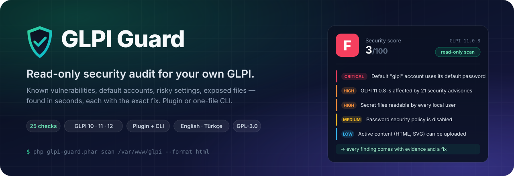
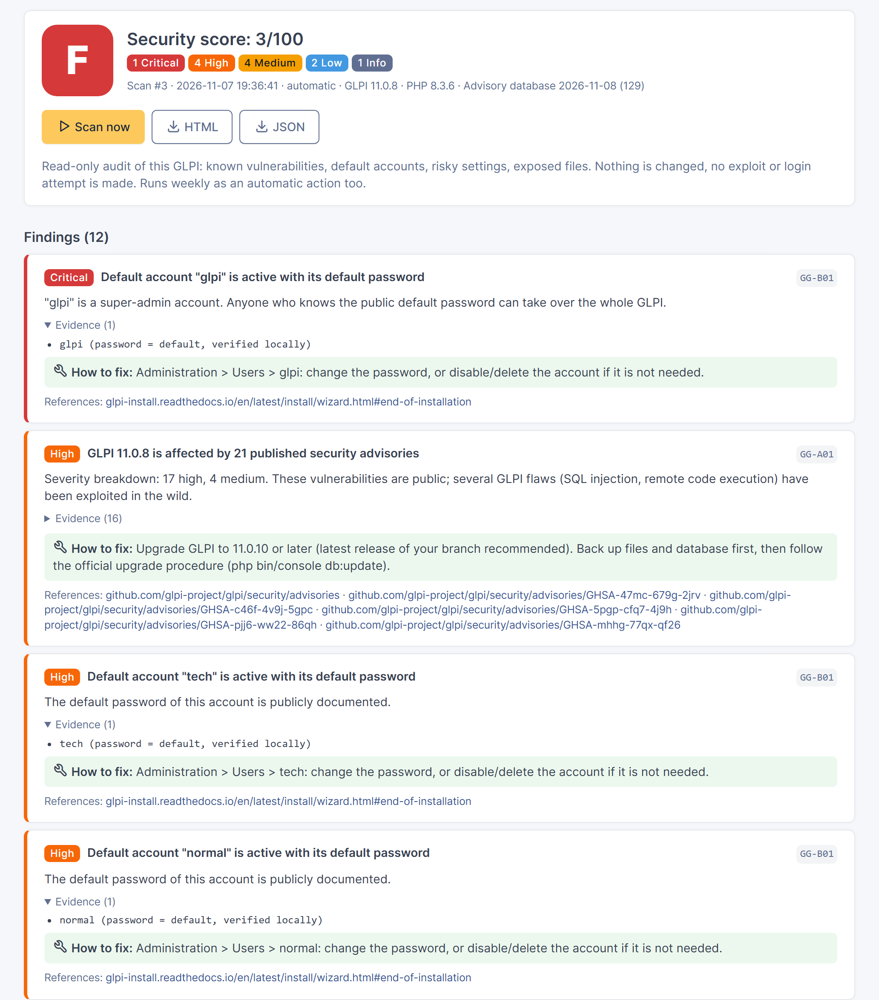
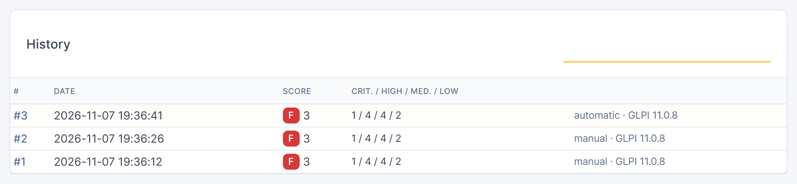
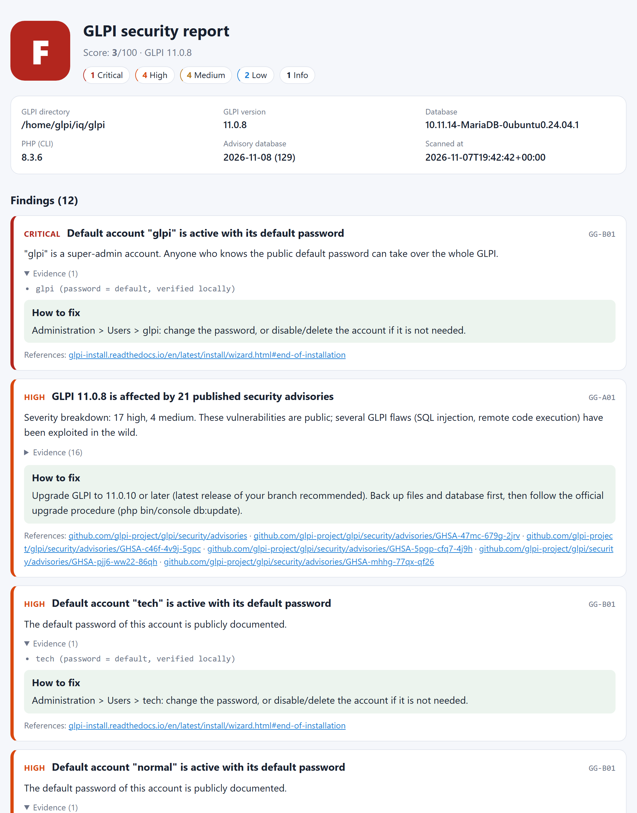
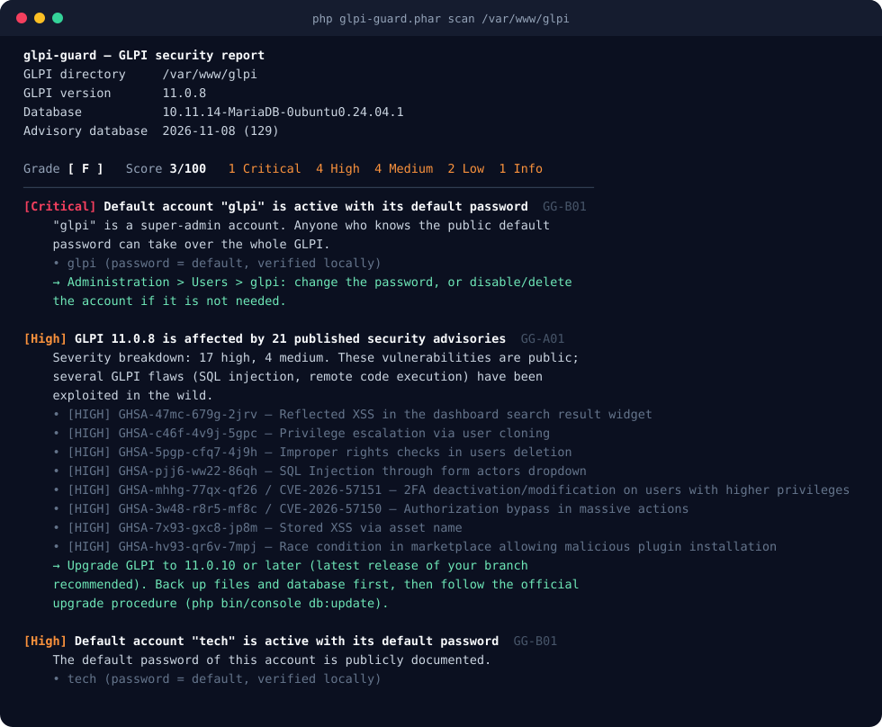
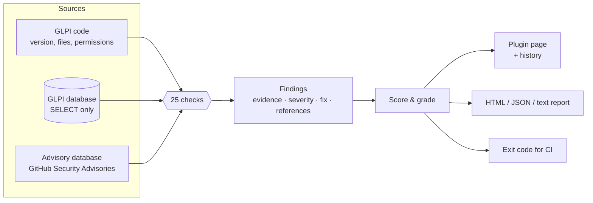

<p align="center">
  
</p>

<p align="center">
  <a href="https://github.com/CodeByPinar/glpi-guard/actions/workflows/ci.yml"></a>
  <a href="https://github.com/CodeByPinar/glpi-guard/releases"></a>
  
  
  
  
  <a href="LICENSE"></a>
</p>

<p align="center">
  <b><a href="#-quick-start">Quick start</a></b> ·
  <a href="#-what-it-checks">Checks</a> ·
  <a href="#-screenshots">Screenshots</a> ·
  <a href="#-how-it-works">How it works</a> ·
  <a href="#-command-line">CLI</a> ·
  <a href="#-faq">FAQ</a> ·
  <a href="#-roadmap">Roadmap</a> ·
  <a href="#-türkçe">Türkçe</a>
</p>

---

**GLPI Guard** tells you, in one click or one command, how exposed your GLPI is — and exactly how to fix it.

It reads your installation the way an auditor would: the GLPI and plugin versions against every published security
advisory, the accounts the installer left behind, password and two-factor policies, the REST API, the files lying
around the web directory, permissions of the secrets, upload rules, mail encryption, rights that let a profile
promote itself… Every finding comes with **evidence**, a **severity**, a **step-by-step fix** and **references**.
The result is a score from 0 to 100 and a grade from A to F you can track over time.

It runs **inside GLPI as a plugin** (dashboard, history, weekly automatic scan) or **from the command line** as a
single file — same engine, same 25 checks.

> [!IMPORTANT]
> GLPI Guard is a **defensive, read-only** tool for installations you are responsible for. It never changes GLPI
> data or settings, never tries an exploit, never attempts a login, and has no feature to scan third-party systems.

## ✨ Highlights

<table>
<tr>
<td width="33%" valign="top">

### 🛡️ Knows the advisories
Compares your GLPI and plugin versions with the **GitHub Security Advisories** of GLPI and 22 widely used plugins,
and tells you the minimum safe version to upgrade to. Works offline; the database is refreshed daily.

</td>
<td width="33%" valign="top">

### 🔑 Finds the classic mistakes
Default `glpi` / `tech` / `normal` / `post-only` accounts with their default password, missing password policy,
admins without 2FA, plain-text LDAP, open API clients, world-readable `config_db.php`, forgotten SQL dumps…

</td>
<td width="33%" valign="top">

### 🧭 Tells you how to fix it
Not just "vulnerable": every finding names the menu path or command that fixes it, in **English or Turkish**,
with links to the official advisory or documentation.

</td>
</tr>
<tr>
<td valign="top">

### 🔒 Read-only by design
SQL limited to `SELECT`/`SHOW`, session switched to `READ ONLY`, default passwords checked **locally** against the
stored hash — never by logging in. Secrets never appear in reports.

</td>
<td valign="top">

### 🧩 Plugin or CLI
A GLPI page for super-admins with history, score trend and a weekly automatic action — or one `glpi-guard.phar`
file for servers, cron and CI (`--fail-on high`).

</td>
<td valign="top">

### 📄 Reports people read
Self-contained HTML report (light & dark), JSON for dashboards and pipelines, colored terminal output. Grade A–F,
score 0–100, findings ordered by severity.

</td>
</tr>
</table>

## 🚀 Quick start

### As a GLPI plugin

```bash
cd /var/www/glpi/plugins
curl -L https://github.com/CodeByPinar/glpi-guard/releases/latest/download/glpiguard.tar.gz | tar xz
php ../bin/console plugin:install -u glpi glpiguard && php ../bin/console plugin:activate glpiguard
# GLPI 10: php ../bin/console glpi:plugin:install -u glpi glpiguard && php ../bin/console glpi:plugin:activate glpiguard
```

Then open **Setup › GLPI Guard** and press **Scan now**. (Or install it from **Setup › Plugins** after extracting
the archive.)

### From the command line

```bash
curl -LO https://github.com/CodeByPinar/glpi-guard/releases/latest/download/glpi-guard.phar
php glpi-guard.phar scan /var/www/glpi
```

Run it as a user that can read the GLPI directory (typically the web-server user). The database connection is read
from GLPI's `config_db.php` — parsed as text, never executed.

## 📸 Screenshots

<p align="center"><b>Inside GLPI</b> — Setup › GLPI Guard</p>
<p align="center"></p>
<p align="center"></p>

<p align="center"><b>Stand-alone HTML report</b> — follows the reader's light / dark theme</p>
<p align="center">
  <picture>
    <source media="(prefers-color-scheme: dark)" srcset="docs/screenshots/report-dark.png">
    
  </picture>
</p>

<p align="center"><b>Terminal</b></p>
<p align="center"></p>

<sub>Screenshots come from a deliberately misconfigured test installation.</sub>

## 🔍 What it checks

| ID | Check | Typical severity |
|---|---|---|
| **A · Versions & advisories** | | |
| `GG-A01` | GLPI version vs. published security advisories — with the minimum safe version | up to **Critical** |
| `GG-A02` | GLPI branch still receives security fixes (derived from recent advisories) | High |
| `GG-A03` | Installed plugins vs. published advisories (Fields, Formcreator, GLPI Inventory, Data Injection…) | up to **Critical** |
| `GG-A04` | PHP version still supported | High |
| `GG-A05` | Database schema matches the installed code (unfinished upgrade) | Medium |
| **B · Accounts & authentication** | | |
| `GG-B01` | Default accounts `glpi`, `tech`, `normal`, `post-only` still using their default password | **Critical** / High |
| `GG-B02` | Too many super-admins, dormant super-admin accounts | Medium / Low |
| `GG-B03` | Password policy disabled or too weak | Medium / Low |
| `GG-B04` | Administrators without two-factor authentication (GLPI 11+) | Medium |
| `GG-B05` | LDAP directories used without TLS | High |
| `GG-B06` | Failed-login volume over 30 days, top source IPs and targeted accounts | High / Medium |
| **C · API** | | |
| `GG-C01` | API clients open to every IP without app token, login with credentials enabled | High / Medium |
| `GG-C02` | Long-lived personal API tokens on super-admin accounts | Medium |
| **D · Files & exposure** | | |
| `GG-D01` | SQL dumps, archives, `phpinfo.php`, Adminer… inside the GLPI directory (worse in `public/`) | High / Medium |
| `GG-D02` | `config_db.php` / `glpicrypt.key` readable or writable by everyone, world-writable code | **Critical** / High |
| `GG-D03` | Inactive or uninstalled plugin code left on disk | Low |
| `GG-D04` | `.git`, `.env` and similar in the GLPI tree | High / Low |
| **F · GLPI configuration** | | |
| `GG-F01` | Users left in debug mode | Low |
| `GG-F02` | Uploadable script (`.php`, `.phar`…) or active-content (`.html`, `.svg`…) document types | **Critical** / Low |
| `GG-F03` | Anonymous ticket creation / follow-ups | Medium / Low |
| `GG-F04` | Unencrypted SMTP, mail collectors without SSL/TLS or certificate validation | Medium / Low |
| `GG-F05` | Automatic actions (cron) not running | Medium |
| `GG-F06` | GLPI configured with a plain `http://` address | High |
| **G · Profiles & rights** | | |
| `GG-G01` | Profiles that can edit profiles without being super-admin (self-promotion) | High |
| `GG-G02` | Administration write rights on self-service profiles | High |

`glpi-guard checks` prints the list for the version you run.

### Scoring

The score starts at **100** and loses **25 / 12 / 5 / 2** points per critical / high / medium / low finding (info
findings cost nothing). Grades: **A** ≥ 90 · **B** ≥ 80 · **C** ≥ 65 · **D** ≥ 50 · **F** below — and a single
critical finding means **F**, whatever the rest.

## ⚙️ How it works



1. **Context** — the GLPI root, version and config directory are detected (including `inc/downstream.php` setups
   such as the Debian package). Inside GLPI the plugin reuses GLPI's own database connection; from the CLI the
   connection is read from `config_db.php` or given with `--db-*` options (use a read-only account if you like).
2. **Checks** — each check is a small class that only reads and returns zero or more findings. A check that
   cannot apply (e.g. 2FA on GLPI 10, Unix permissions on Windows) is reported as *skipped*, never as an error.
3. **Advisories** — `data/advisories.json` ships with the tool. A GitHub Action rebuilds it daily from the published
   advisories and opens a pull request that a human reviews.
4. **Report** — findings are ordered by severity, scored and rendered. In the plugin each scan is stored (last 100),
   so you can follow the score after every fix.

### What it never does

| | |
|---|---|
| ❌ Write to GLPI's database or files | the plugin only writes its own history table |
| ❌ Exploit, fuzz or "verify" a vulnerability | versions and configuration are enough |
| ❌ Try a password over the network | default passwords are checked against the stored hash, locally |
| ❌ Scan other people's GLPI | there is no discovery or remote-target feature, and there will not be |
| ❌ Put secrets in reports | evidence shows names and settings, never passwords, hashes or tokens |
| ❌ Phone home | no telemetry; works fully offline |

## 🧩 The plugin

- **Where:** Setup › GLPI Guard, visible only to users who can change the general configuration.
- **Scan now** — results in a few seconds; language follows the user's GLPI language (`?lang=en|tr` to switch).
- **History** — the last 100 scans with grade, score, counts per severity and a score trend.
- **Downloads** — any scan as a stand-alone HTML report or as JSON.
- **Automatic action** `glpiguardscan` — weekly scan (Setup › Automatic actions; runs with GLPI's cron).
- **Footprint** — one table (`glpi_plugin_glpiguard_scans`) and one automatic action, both removed on uninstall.

| | GLPI 10.0 | GLPI 11.0 | GLPI 12.0 |
|---|:-:|:-:|:-:|
| Plugin | ✅ | ✅ | ✅ |
| CLI | ✅ | ✅ | ✅ |
| 2FA check (`GG-B04`) | skipped (no built-in 2FA) | ✅ | ✅ |

Tested on GLPI 10.0.26, 11.0.8 and 12.0.0 with MariaDB 10.11. The engine supports PHP 7.4 and later; CI runs PHP
7.4 → 8.4.

## 💻 Command line

```text
glpi-guard scan <glpi-dir> [options]
glpi-guard checks [--lang tr]
glpi-guard --version
```

| Option | Description |
|---|---|
| `--format text\|json\|html` | Output format (default `text`) |
| `--output <file>` | Write the report to a file |
| `--lang en\|tr` | Report language (default: `tr` when `LANG` starts with `tr`, else `en`) |
| `--fail-on <severity>` | Exit with code 1 when a finding of this severity or worse exists (`critical`, `high`, `medium`, `low`, `info`, `none`) |
| `--only GG-A01,GG-B01` / `--skip GG-F06` | Select checks |
| `--config-dir <dir>` | GLPI config directory (auto-detected) |
| `--db-host` `--db-user` `--db-pass` `--db-name` | Override the connection from `config_db.php` |
| `--no-db` | File-system checks only |
| `--advisories <file>` | Use another advisory database |
| `--no-color` | Plain text |

**Exit codes:** `0` OK · `1` findings at or above `--fail-on` · `2` usage or runtime error.

### Recipes

```bash
# Monthly HTML report in Turkish, kept next to your backups
php glpi-guard.phar scan /var/www/glpi --lang tr --format html --output /var/backups/glpi-guard-$(date +%F).html

# Fail a deployment pipeline when something high or critical appears
php glpi-guard.phar scan /var/www/glpi --format json --fail-on high > glpi-guard.json

# Dedicated read-only database account
php glpi-guard.phar scan /var/www/glpi --db-user glpiguard_ro --db-pass "$GG_DB_PASS"
```

<details>
<summary>Create a read-only MariaDB/MySQL account</summary>

```sql
CREATE USER 'glpiguard_ro'@'localhost' IDENTIFIED BY 'a-long-random-password';
GRANT SELECT ON glpi.* TO 'glpiguard_ro'@'localhost';
```
</details>

<details>
<summary>Sample JSON (truncated)</summary>

```json
{
  "meta": { "tool": "glpi-guard 0.1.0", "glpi": "11.0.8", "runtime": "cli", "advisory_db": "2026-11-08" },
  "score": 3,
  "grade": "F",
  "counts": { "critical": 1, "high": 4, "medium": 4, "low": 2, "info": 1 },
  "findings": [
    {
      "check": "GG-B01",
      "severity": "critical",
      "title": "Default account \"glpi\" is active with its default password",
      "fix": "Administration > Users > glpi: change the password, or disable/delete the account if it is not needed.",
      "evidence": ["glpi (password = default, verified locally)"],
      "refs": ["https://glpi-install.readthedocs.io/en/latest/install/wizard.html#end-of-installation"]
    }
  ]
}
```
</details>

## 🆚 How it compares

| | **GLPI Guard** | [glpwnme](https://github.com/Orange-Cyberdefense/glpwnme) | GLPI's own checks |
|---|---|---|---|
| Audience | Administrators, security & audit teams | Penetration testers | Administrators |
| Approach | Inside, read-only | Outside, can exploit known flaws | A few requirement warnings |
| Default accounts | ✅ local hash check | ✅ login attempts | — |
| Known vulnerabilities | ✅ GLPI + plugins, minimum safe version | ✅ selected CVEs | — |
| Configuration & rights review | ✅ | — | partial |
| Fix for each finding | ✅ | — | — |
| History, score, scheduled scans | ✅ (plugin) | — | — |

The two tools complement each other: glpwnme shows what an attacker can do, GLPI Guard is the defender's checklist.

## ❓ FAQ

<details>
<summary><b>Is it safe to run on production?</b></summary>

Yes — that is what it is for. It only reads (SQL `SELECT`/`SHOW`, file metadata) and the CLI switches its database
session to read-only. A scan takes a few seconds; the heaviest query reads the last 30 days of login events.
</details>

<details>
<summary><b>Does it need internet access?</b></summary>

No. The advisory database is inside the plugin/phar. Update the tool (or `data/advisories.json`) to get newer
advisories.
</details>

<details>
<summary><b>Why does it say my GLPI is affected when I applied a patch by hand?</b></summary>

Advisory matching uses the version number. If you back-ported a fix, document it and skip the check
(`--skip GG-A01`) or accept the finding; a "risk accepted" status is on the roadmap.
</details>

<details>
<summary><b>Can I scan a GLPI I do not manage?</b></summary>

No. GLPI Guard needs local access to the installation directory and database, and it has no remote-scanning
feature by design.
</details>

<details>
<summary><b>Why is a check "skipped"?</b></summary>

It does not apply here (e.g. two-factor authentication does not exist in GLPI 10, Unix permissions on Windows) or
the database is not reachable with `--no-db`. Skipped checks do not change the score.
</details>

<details>
<summary><b>My GLPI language is Turkish, I need the report in English.</b></summary>

CLI: `--lang en`. Plugin: add `?lang=en` to the page URL, or download the HTML/JSON report with `lang=en`.
</details>

## 🗺️ Roadmap

- [x] 25 read-only checks, score & grade, text / JSON / HTML reports (EN, TR)
- [x] GLPI plugin: dashboard, history, downloads, weekly automatic action
- [x] Offline advisory database refreshed by CI
- [ ] HTTP checks against your own URL (`--url`): web root, exposed `files/` `config/` `install/`, security headers, cookies, TLS
- [ ] E-mail report after the weekly scan
- [ ] "Risk accepted" status with justification and expiry
- [ ] `--baseline` diff between two scans
- [ ] More plugins in the advisory database, community-maintained rules
- [ ] Docker test matrix (GLPI 9.5 → 12), documentation site, signed releases

Ideas and check requests are welcome in [issues](https://github.com/CodeByPinar/glpi-guard/issues).

## 🛠️ Development

```bash
git clone https://github.com/CodeByPinar/glpi-guard.git && cd glpi-guard
php tests/run.php                              # unit tests, no database needed
php bin/glpi-guard scan /path/to/glpi          # run from source
php tools/fetch-advisories.php                 # rebuild data/advisories.json (set GITHUB_TOKEN)
php -d phar.readonly=0 tools/build-phar.php    # dist/glpi-guard.phar
php tools/build-plugin.php                     # dist/glpiguard-<version>.tar.gz
```

```text
setup.php · hook.php · front/       GLPI plugin entry points
src/                                engine (namespace GlpiGuard\, no GLPI dependency)
src/Checks/                         one class per check
src/Report/                         text and HTML renderers
src/{Menu,Scan,Panel,PluginContext}.php   plugin classes (GlpiPlugin\Glpiguard\)
bin/glpi-guard                      CLI entry point
data/                               advisory database, PHP support dates
tests/                              dependency-free test runner + fake GLPI
tools/                              build scripts, advisory fetcher, README artwork
```

Writing a check takes a few minutes — see [CONTRIBUTING.md](CONTRIBUTING.md).

## 🔐 Security

Found a vulnerability **in GLPI or a plugin**? Report it privately to its maintainers, not here. Found one **in
GLPI Guard**? Use GitHub's private vulnerability reporting. Details in [SECURITY.md](SECURITY.md).

## 📜 License

[GPL-3.0-or-later](LICENSE), like GLPI. GLPI is a trademark of Teclib'; GLPI Guard is an independent community
project, not affiliated with Teclib'.

---

## 🇹🇷 Türkçe

**GLPI Guard**, kendi GLPI kurulumunuzun ne kadar açıkta olduğunu tek tıkla ya da tek komutla gösterir — ve her
sorunun **nasıl düzeltileceğini** söyler.

- **Bilinen açıklar:** GLPI ve eklenti sürümlerinizi yayımlanmış tüm güvenlik duyurularıyla karşılaştırır, en az
  hangi sürüme geçmeniz gerektiğini yazar. İnternet gerekmez.
- **Klasik hatalar:** varsayılan şifreli `glpi`/`tech`/`normal`/`post-only` hesapları, kapalı parola politikası,
  iki adımlı doğrulaması olmayan yöneticiler, TLS'siz LDAP, herkese açık API istemcileri, herkesin okuyabildiği
  `config_db.php`, unutulmuş SQL dökümleri, kendi yetkisini yükseltebilen profiller…
- **Her bulguya çözüm:** menü yolu ya da komutla düzeltme adımı, kanıt ve kaynak. Türkçe ve İngilizce.
- **Salt okunur:** GLPI'ye hiçbir şey yazmaz; açık denemez, giriş denemez, başka sistemleri taramaz. Varsayılan
  şifre kontrolü sunucuda, kayıtlı özetle yapılır. Rapora şifre, özet ya da belirteç girmez.
- **Puan ve not:** 0–100 puan, A–F not; tek bir kritik bulgu notu F yapar.

### Eklenti olarak

1. `glpiguard.tar.gz` dosyasını GLPI'nin `plugins/` klasörüne açın.
2. **Kurulum › Eklentiler**'den kurup etkinleştirin (ya da `php bin/console plugin:install -u glpi glpiguard`).
3. **Kurulum › GLPI Guard › Şimdi tara.**

Sayfayı yalnızca genel yapılandırmayı değiştirebilen (süper yönetici) kullanıcılar görür. Son 100 tarama geçmişi,
puan grafiği, HTML/JSON rapor indirme ve haftalık otomatik tarama (`glpiguardscan`) vardır. Eklenti yalnızca kendi
tablosuna yazar; kaldırınca tablo ve otomatik eylem silinir.

### Komut satırından

```bash
php glpi-guard.phar scan /var/www/glpi --lang tr
php glpi-guard.phar scan /var/www/glpi --lang tr --format html --output glpi-rapor.html
php glpi-guard.phar scan /var/www/glpi --fail-on high   # CI: yüksek ve üstü bulguda çıkış kodu 1
```

<p align="center"><sub>Made with care by <a href="https://github.com/CodeByPinar">@CodeByPinar</a> · if GLPI Guard helped you, a ⭐ helps others find it.</sub></p>
